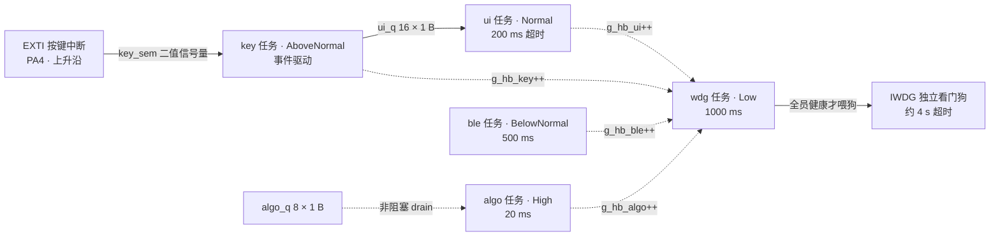

# STM32 + FreeRTOS 智能手环原型

基于 STM32F103C8T6 + FreeRTOS（CMSIS-RTOS v2）的可穿戴设备原型，重点是**实时事件处理链路**与**系统级故障自愈**：按键事件从 EXTI 中断一路走到 UI 任务不丢一个，任一任务卡死时看门狗能在约 4 秒内复位系统，并且复位后还能回答"是谁卡死了、卡了多久"。

## 硬件

| 项目 | 说明 |
| --- | --- |
| MCU | STM32F103C8T6（Cortex-M3） |
| 显示 | ST7789 IPS 240×240 彩屏（**SPI1**：`PA5 = SCK` / `PA7 = MOSI`；控制线 `PA0 = CS` / `PA1 = DC` / `PA2 = RST` / `PA3 = BLK`。驱动见 `Core/Src/st7789.c` + `Core/Src/lcd.c`） |
| 姿态 | MPU6050（I2C1：**PB8 = SCL / PB9 = SDA**，从机地址 0x68，驱动 `Core/Src/mpu6050.c`） |
| 按键 | PA4 + EXTI（上升沿触发，按下为高电平；改为低电平有效只需改 `KEY_ACTIVE_LEVEL` 并翻转触发沿） |
| 调试输出 | USART1（PA9 / PA10，115200）。⚠ `printf` **目前不可用**：`syscalls.c` 里的 `__io_putchar` 只有 weak 声明、全项目没有实现，一调用就跳地址 0（HardFault）。所以本项目的诊断手段是 `volatile` 全局变量 + 调试器现场表达式，不是串口打印 |
| 看门狗 | IWDG（LSI 约 40 kHz，分频与 reload 见 `Core/Src/iwdg.c`，超时约 4 s） |
| 工具链 | STM32CubeIDE + STM32CubeMX |

## 显示：从 SSD1306 换到 ST7789

原先是一块 I2C 的 SSD1306 单色 OLED（128×64，1 bpp）。换成 ST7789 的 SPI 彩屏（240×240，RGB565）之后，驱动分成三层，每个改动的落点是明确的：

```
任务代码（freertos.c 的 ui 任务、main.c）
    │  只 include 这一个头文件
    ▼
  lcd.h / lcd.c          ← "字符""字符串""矩形""数字转字符串"这一层的语义
    │
    ▼
  st7789.c               ← SPI 事务、CS/DC/RST、窗口寄存器、RGB565 字节序
```

分辨一个改动该放哪层很简单：提到 SPI / CS / DC / 窗口的属于底层；提到字符 / 矩形 / 居中的属于 lcd 层。**换屏只改 `lcd.c`，任务代码一行不动。**

### 为什么没有 framebuffer

整屏 240×240×2 = 115200 字节，而 F103C8T6 一共只有 20KB RAM —— **装不下**。所以没有离屏画布，所有绘制都是"直接往屏上写"。由此带来两条必须记住的约束：

- **画上去就擦不掉。** 要改内容必须先用背景色把那一块盖掉、再画新的。`lcd_draw_char()` 的 `bg` 参数、以及 `ui_draw_bar()` 里"先填一块背景再写数字"都是为这个存在的。少擦一步的症状不是花屏，而是上一帧的内容留在原地（例如数值从 `-12345` 变成 `-99`，后面会杵着一段 `345`）。**屏幕上一切奇怪的东西，第一个要怀疑的都是"没擦干净"。**
- **没有"先画好再整体切换"。** 刷新时屏上会出现短暂的中间状态，这是设计的固有部分，不是 bug。

绘制统一走"设窗口 + 连续灌像素"：`st7789_blit_begin()` 设定一块矩形窗口，`st7789_blit_data()` 反复推进，`st7789_blit_end()` 收尾。全程只经过一个 480 字节的行缓冲 —— 这是整套设计里最省内存的一步，也是整屏 RGB565 能在 20KB RAM 里画出来的原因。

### 差分刷新：被实机逼出来的设计

第一版 UI 是"每 200 ms 把整页重画一遍"。跑起来立刻暴露三个问题，而且都是同一个根因：

| 现象 | 原因 |
| --- | --- |
| **周期性频闪** | 柱状条区域每帧都被"填一次底色再重画"，200 ms 一轮就是 5 Hz 的闪烁 |
| **不够跟手** | 一帧要推约 70 KB，@9 MHz 光传输就吃掉一半以上时间，按键后最坏要等整整一帧 |
| **换页不像"整页切换"** | 没有 framebuffer，清屏和绘制都是逐行扫过去的，过程全程可见 |

根因是"无条件全量重绘"。改成**差分刷新**之后前两个直接消失：把上一次画出来的形状记住，这一帧只写"和上次不一样"的那一段。

- **柱状条**：条从中心线往两边长，所以把旧形状和新形状各截成 `[左端, 0)` 与 `[0, 右端)` 两段分别比，永远只有三种情况 —— 旧有新无（擦回底色）、新有旧无（补画）、两边都有（不动）。一帧通常只写几列像素。**换向**（正变负）会被自然分解成"擦掉旧的 + 画上新的"，不需要对符号特判。
- **数值文字**：加了 16 LSB 的死区。不加的话，静止时加速度那 ±1 的抖动会让文字每帧重画一次，看上去就是数字在原地抖 —— 比不刷新更难受。
- **静态元素**（标题、分隔线、条底、中心线）：只在换页后的第一帧画一次，之后一直不碰。
- **ui 节拍**从 200 ms 提到 **50 ms**。这是差分换来的资格 —— 一帧传输量从约 70 KB 降到几百字节，才轮得到聊"跟不跟手"。

> ⚠ **换页时所有差分状态必须作废**（`ui_invalidate()`）。否则新页会拿着上一页的记录去做差分，该画的没画，屏幕上就是一片残缺。这是这类优化的典型陷阱：省下来的每一次写入，都对应着一个"状态必须同步失效"的义务。

**换页仍然会全屏扫描，这是没有双缓冲的固有代价**，不打算靠"清得更快"去遮掩，只能把它压短 —— 见下面 SPI 速率那条。

### 字库

`Core/Src/font8x16.c` 是 8×16 的 ASCII 点阵（0x20 ~ 0x7E，95 个字符，共 1520 字节，全在 Flash 里、不占 RAM）。它是**自动生成**的，不要手改：

```bash
pip install pillow           # 只有需要重新生成字库时才用得到（整个固件不依赖 Python）
python tools/gen_font.py     # 用 PIL 把 Consolas 14px 渲染成点阵，输出到 Core/Src 与 Core/Inc
```

生成出来的文件里，每个字符上方都附了对应的点阵图（`#` 和 `.`），对着图看比数十六进制快得多 —— 这也是把图一起生成出来的原因。8 像素宽的格子最多容纳 14px 的等宽字体，再大就裁边，所以**不做第二套字号**：要大字就用 `lcd_draw_str()` 的 `scale` 参数整数倍放大，一套字库两种显示大小。

### 上电五色自检，以及为什么"黑"必须排第一

`main()` 里保留了一段"黑 → 白 → 红 → 绿 → 蓝"的自检。留着它不是为了好看，而是因为它是**不用调试器就能判断屏还活着**的探针 —— 下面那条踩坑记录会说明这个探针为什么值得占那 1.25 秒。

颜色顺序也不是随便排的，**"黑"必须放第一个**：

> ST7789 上电未初始化时屏本身就是白的（GRAM 内容不定 + IPS 面板）；初始化完毕但一个像素都没写进去、GRAM 全 `0x0000` 再被 `INVON` 反显，**同样也是白的**。所以"看到白色"区分不了"没跑初始化"和"命令到了但像素没到"这两种情况，什么也证明不了。只有真的刷黑了，才说明 命令 → 窗口 → 像素 这条通路是通的。

### 踩坑：接触不良是怎么伪装成"驱动没写好"的

这次换屏耗掉最久的一个故障，症状是：**固件侧一切正常**（`g_spi_tx_ok` 和预期值一字不差、`g_spi_tx_err = 0`、SPI 状态 READY），**背光亮，但屏上什么都没有，一直白。**

排查走了两个弯路，都是方法上的问题，跟驱动代码无关：

- **"用 LED 测过线都是通的"，就以为接线没问题。** 通断测试回答的是"这根导线两端是不是同一个电气节点"，它**天然看不见接错位置**：把 SCL 接到 PA7、SDA 接到 PA5，两根线各自照样是通的、LED 照样亮。这一类错误对通断测试完全透明。
- **把"背光亮"当成了接线正确的证据。** 很多模块的 BLK 是模块自己从 VCC 取的，根本不由 MCU 控制。验证方法很简单：把那根线从 MCU 上拔掉 —— 背光要是还亮，说明这个现象一直是无效证据。

最后的原因很朴素：**杜邦线接触不良**。它最难缠的地方在于**间歇性** —— 静态测量全过，一上 9 MHz 的时钟就不认。所以遇到"固件全通、接线全通、屏全无反应"这个组合，第一件事应该是把线重插或焊死，而不是继续怀疑初始化序列。

> **教训：先让故障可判定，再去找原因。** 这次真正起作用的是两样东西 —— "刷黑"这个实验（黑是唯一能排除"屏本来就是白的"这个假象的颜色），以及用 `g_spi_tx_ok` 把"固件发没发出去"和"屏收没收到"彻底切开。有了这两样，剩下就只是体力活。

## I2C1 总线：为什么用 PB8 / PB9

F103 的 I2C1 有两组引脚：默认组 `PB6 = SCL / PB7 = SDA`，重映射组 `PB8 = SCL / PB9 = SDA`。本项目走重映射组，而且**必须在配置引脚之前打开 AFIO 重映射**：

```c
__HAL_AFIO_REMAP_I2C1_ENABLE();   /* 漏掉这行，PB8/PB9 就只是两个普通 GPIO，I2C1 还留在 PB6/PB7 上 */
```

切换的原因是一次真实的踩坑：原来的 **PB6/SCL 那一路没有外部上拉**（模块侧那颗上拉电阻根本没接到 MCU）。开漏输出只能拉低、不能拉高，于是 SCL 出不了上升沿 → 从机看不到时钟 → 一个都不应答 → **OLED 全黑**，而且每次 NAK 之后 F1 的 I2C 还会把 BUSY 锁死，症状一路伪装成"总线上没有器件"。

> 那块 OLED 后来退役了（换成 SPI 的 ST7789），但这一路 I2C 还在用 —— MPU6050 挂在上面。下面这整套恢复逻辑和取证探针**不能跟着 OLED 一起删**：它们治的是 F103 的 I2C 外设本身，跟总线上挂的是哪种器件无关。总线体检 `i2c_selftest()` 也因此从 `ssd1306.c` 搬到了 `i2c.c`（它本来就和"怎么显示"没关系）。

这个过程在代码里留了两样东西：

- **`i2c1_recover_bus()`：处理 F1 的 BUSY 假死。** `SR2.BUSY` 的置位条件只有一条 ——"检测到 SDA 或 SCL 为低"；一旦锁上，之后每次 `HAL_I2C_xxx` 都要先白等满 25 ms 才返回 `HAL_BUSY`（`I2C_TIMEOUT_BUSY_FLAG` 是 HAL 里写死的值，改 `Timeout` 参数没用）。**清它只有"整个外设复位"一条路**（`__HAL_RCC_I2C1_FORCE_RESET()`）；关/开 PE、重写一遍寄存器都不行。恢复前还要先把两条线松开抬到高电平，否则一使能 PE 就立刻又锁上（实测这一步做与不做，成功率直接是 1 比 8）。
- **`I2C_BUS_FORENSICS`：总线取证探针（默认关）。** 置 1 后，每次进恢复流程会把外设从线上摘下来，分别用 MCU 内部上拉/下拉各读一次 SCL/SDA：

  | 上拉探针 | 下拉探针 | 说明 |
  | --- | --- | --- |
  | 1 | 1 | 外面有上拉（几 kΩ）→ 这条线是通的 ✔ |
  | 1 | **0** | **外面什么都没有，纯悬空 → 这条线没接到模块** |
  | 0 | 0 | 外面被硬拉低：短路到 GND / 从机死拉 / 未上电器件钳位 |
  | 0 | 1 | 外面硬接了高电平（接错到 VCC） |

> 教训：I2C 出问题时，先把"上拉到底有没有"变成一个可以读的数，比换线、换模块、改速率都省事。

## 软件架构：5 个任务 + 2 个队列 + 1 个信号量

| 任务 | 优先级 | 节拍 | 职责 |
| --- | --- | --- | --- |
| `algo` | High | 20 ms | 三轴采集 + 一阶低通 + 计步；以非阻塞方式 drain `algo_q` |
| `key` | AboveNormal | 事件驱动 | 信号量唤醒 → 20 ms 消抖窗口 → 确认后投 `ui_q` |
| `ui` | Normal | 200 ms 超时 | 消费 `ui_q`、翻页、经 `lcd.h` 画屏（HOME 页三条加速度条 / INFO 页系统状态） |
| `ble` | BelowNormal | 500 ms | 预留蓝牙数据上报 |
| `wdg` | Low | 1000 ms | 心跳巡检 + 决定喂狗 / 停喂 |

任务间通信：

- `key_sem`：二值信号量。**EXTI 中断里只做 `osSemaphoreRelease`**，把消抖、判定、入队这些耗时工作全部甩给 `key` 任务，中断服务时间压到最短。
- `algo_q`（8 × 1 B）、`ui_q`（16 × 1 B）：事件码 `evt_t` 故意只占 1 字节，和队列 Item Size 严丝合缝，不浪费一个字节的拷贝。

### 任务关系图



> 实线是数据通路（信号量 / 队列），虚线是心跳与巡检关系。`algo_q` 目前只保留消费侧。

## 看门狗 + 多任务心跳监控

表驱动结构 `hb_mon_t g_mon[]` 登记每个受监控任务的**心跳变量地址**和**容忍停滞秒数**：

```c
hb_mon_t g_mon[] = {
  { .name = "algo", .hb = &g_hb_algo, .limit = 2 },
  { .name = "ui",   .hb = &g_hb_ui,   .limit = 2 },
  { .name = "ble",  .hb = &g_hb_ble,  .limit = 3 },
};
```

`wdg` 任务每秒取一次快照：心跳值没变 → 停滞秒数 +1，变了 → 清零；停滞秒数 ≥ `limit` 即判定该任务已死。**全部任务健康才刷新 IWDG，只要有任意一个被判定卡死就停止喂狗**，靠硬件看门狗做最终恢复手段。表驱动的好处是新增一个受监控任务只需加一行配置。

### 武装时机：看门狗不监督"启动过程"，只监督"已经站起来的系统"

`MX_IWDG_Init()` 刻意放在 `main()` 里所有启动逻辑跑完之后、`osKernelStart()` 之前，而不是紧跟在外设初始化后面：

- IWDG 一写就开跑，且**无法暂停**；而第一次喂狗要等 `wdg` 任务跑完第一轮 `osDelay(1000)`。也就是说留给"复位 → 调度器起来 + 1 s"的预算只有约 3 秒（超时约 4 秒）。
- 中间那段启动体检在总线异常时想吃掉好几秒太容易了：`i2c_scan` 扫 112 个地址，I2C 卡死时每个地址要白等满 25 ms 的固定 BUSY 超时（`I2C_TIMEOUT_BUSY_FLAG`，改 `Timeout` 参数没用），单这一项就是 2.8 秒。
- 一旦超时就是"上电即复位"，而那次复位发生在调度器启动之前 —— `wdg` 任务永远跑不到，下面那套 boot loop 防护也无从生效，于是变成真正的死循环。

顺带把 `i2c_scan` 的两处启动期开销压掉了：单地址超时 10 ms → 2 ms，并加了"BUSY 不放就立刻放弃扫描"的短路（否则 112 个地址会一个接一个白等过去）。

## 复位之后还能复盘：死亡档案

停喂之前，把"第几个任务 + 停滞了多少秒"写进**备份域寄存器**（`BKP->DR3` / `BKP->DR4`，跨复位不丢），复位后由 `main()` 读出来，于是可以明确回答：

> `algo` 连续停滞 7 秒 → 独立看门狗复位系统

同时：

- `BKP->DR1` 复位计数；`BKP->DR10` 数据签名（签名不对就整份作废，避免读到脏数据）
- 读 `RCC->CSR` 判定复位来源（`IWDGRSTF` 看门狗复位 / `PORRSTF` 上电复位 / `PINRSTF` 引脚复位），读完写 `RMVF` 清掉粘滞标志，为下一次复位做准备

## Boot loop 防护

如果系统一启动就死、复位后又立刻死，会陷入无限重启。这里用 `BKP->DR2` 记连续未存活复位次数：超过 `BOOT_LOOP_MAX` 就判定为疑似 boot loop，允许"带病喂狗"把设备拉起来（并把带病喂狗的秒数单独计数，不和正常喂狗混在一起）；一旦累计存活到 `HEALTHY_SEC` 且期间无死件，就往 `BKP->DR2` 盖一个"够本"印章并撤销 guard。

## 按键与导航：三颗键、三种语义、三个状态

### 硬件

| 键 | 引脚 | EXTI | 物理位置 |
| --- | --- | --- | --- |
| 上一个 | **PB5** | EXTI9_5 | 左 |
| 确认 | **PA4** | EXTI4 | 中（原来那颗） |
| 下一个 | **PB6** | EXTI9_5 | 右 |

**电平约定：按下接高电平**（上升沿触发 + 内部下拉）。三颗键保持一致。如果你的按键是"按下接地"，改 `keys.c` 里两处即可（`IT_RISING` → `IT_FALLING`、`PULLDOWN` → `PULLUP`），别的地方都不用动。

> **EXTI 分配有个坑**：F1 上 EXTI5~9 **共用同一个中断向量** `EXTI9_5_IRQHandler`。所以 PB5/PB6 落在一起，而 PA4 独占 EXTI4。这个处理函数**必须手写在 `stm32f1xx_it.c` 的 USER CODE 区**——`.ioc` 里没给 PB5/PB6 配 EXTI，生成区不会产出它，而中断向量表里那个名字指向的是默认弱定义：**不自己实现，按键按下去永远没反应，而且不报任何错**。

`keys.c` 独立成模块而不并进 `gpio.c`，是因为 `gpio.c` / `main.h` 属于 CubeMX 生成区，引脚定义放那儿下次重新生成就丢了。

### 导航状态机

```
  主页(时间)  ──任意键──►  菜单(卡片)  ──左/右──►  上下选
                              ▲                      │
                              │                   [确认]
                              │                      ▼
                           [返回]  ◄────────────  细分页
                              │
                          [回到主页] ──────────►  主页(时间)
```

按键语义**完全由当前状态决定**，物理键位始终是左-中-右，用户不用记"这个键现在是什么"：

| 状态 | 左（PB5） | 中（PA4） | 右（PB6） |
| --- | --- | --- | --- |
| **主页**（时间） | 进菜单 | 进菜单 | 进菜单 |
| **菜单**（卡片） | 上一个 | 进入选中页 | 下一个 |
| **细分页** | **返回上一步**（回菜单） | **确认**（页面动作） | **回到主页** |

菜单里有三项：STEPS / ACCEL / INFO。**时间不在菜单里——它本身就是主页。** ACCEL（三条加速度柱状条）原来占着主页的位置，现在降级成菜单项：它本质上是调试视图。

> `EVT_KEY_PRESS`（旧的那个笼统事件码）保留了，但里面已经没人发它了 —— 三个物理键各有自己的事件码。之所以趁早分开：ui 的按键语义随状态变，在队列这一层就把"是哪个键"分清楚，ui 那边只需要按状态查表，不用再回头猜。

### 细分页里"确认"做什么

由每页自己定。目前只有**步数页**有实质动作，其余先留空——等页面本身定下来再填。入口是 `ui_detail_action()`。

**动作必须是二次确认的。** 步数清零最初写成"一按就清"，那样太危险：用户想"确认"点什么，手一抖就把累积的步数弄没了，而且找不回来。现在改成第一次按只弹提示"再按确认清零"、**3 秒内**再按一次才真的清。

> 超时取消那一步不能省。不做的话提示会一直挂在屏幕上，而且隔了半小时再按一次确认会被当成"第二下"、把步数清掉——那两次按键在用户看来毫无关系。
>
> 另外注意 `ui_confirm_hint()` 里"不显示"也是一种状态：**提示消失时必须主动把这行擦掉**。本屏没有 framebuffer，不擦的话"再按确认清零"会一直留在屏幕上。

## 汉字：按需子集，不是整字库

界面要中文，但**整 GB2312 装不下**：6763 个汉字 × 16×16 点阵 = **216 KB**，而 F103C8 一共只有 64 KB Flash、已经用掉 45 KB。

所以只生成**真正用到的字**：`tools/gen_hz.py` 里改一行 `HANZI` 字符串、跑一遍脚本即可。当前 30 个字，**960 字节**。

```bash
python tools/gen_hz.py      # 改 HANZI 里的字表，重新生成 hz16.c / hz16.h
```

生成的文件里每个字都附了点阵图（和 `font8x16` 一样），对照着看比数十六进制快得多。

### 为什么字库存 UTF-8 原文而不是用枚举

调用处可以直接写：

```c
lcd_draw_hz_str(x, y, "步数", fg, bg, 2);
```

人一眼能看懂。如果做成 `HZ_BU` / `HZ_SHU` 这样的枚举，加个字就要同时在两处维护，而且看代码的人得回去查表才知道画的是什么。代价是查找要走一遍字符串比对——这是一张十几项的线性表，比维护枚举省心得多。

### 中英文可以混排

`lcd_draw_hz_str()` 会自己判断 UTF-8 是几字节：汉字（3 字节）占满 16×16 的格子，ASCII 则**居中**放进同样宽的格子里，不会全挤在左边跟汉字对不齐。所以 `"步数 123"` 这种混排可以直接画。

> 注意 `lcd_str_width()` 是给纯 ASCII 用的（一个字节一个字符地数），**中文要用 `lcd_hz_str_width()`** —— 用错的话宽度直接算错、字也排不到中间。

字库里没有的字会画成一个空位（填背景色）而不是留白——本屏没有 framebuffer，留白会留下上一帧的残影、看着像乱码，空位至少能看出"这里有个字但没数据"。

## 时间：RTC 时钟源自动选择

这部分的核心问题不是"怎么读 RTC"，而是**时间从哪来**。F103 的 RTC 时钟源只能三选一：

| 时钟源 | 精度 | 掉电能否保持 |
| --- | --- | --- |
| **LSE**（外部 32.768 kHz 晶振） | 晶振 ±20 ppm，准 | 能（前提是 VBAT 有电） |
| **LSI**（内部 RC） | ±5% 起步，**一天能差一两小时** | 能走，但精度没意义 |
| HSE÷128 | 也很准 | **不能**，HSE 一停 RTC 就停 |

而 Blue Pill 板上**通常不焊那颗 32.768 kHz 晶振**。所以 `rtc_time_init()` 上电先试 LSE（自己控 300 ms 超时），试不通自动回退 LSI，并把实际生效的那个写进 `g_rtc_src` —— **INFO 页上直接显示**，以后换板子也不用改代码。

> 为什么不直接用 HAL：`HAL_RCC_OscConfig` 等 LSE 起振用的是 `LSE_TIMEOUT_VALUE = 5000 ms`，板上没晶振时每次上电要干等 5 秒；自己写能压到 300 ms。而且 HAL 的 RTC 初始化会顺手把计数器清零，我们却需要在"备份域还活着"时保留原值 —— 所以这里直接操作 BDCR / CRL / PRL / CNT 这几个寄存器，反而更短也更可控。

### 软复位不能把时间冲掉

看门狗复位是常态。那种情况下备份域没断电、RTC 秒数还是对的，**必须原样保留**。所以初始化分两条路：

- **备份域还活着、时钟源也没变** → 什么都不动，时间连续
- **真断过电，或者时钟源变了** → 复位备份域、重配 RTC、用**编译时刻**（`__DATE__` / `__TIME__`）置初值

第二条路的效果是：**每次烧录之后，时间天然就是对的**（就是烧录那一刻）。代价是断电重启会退回上次烧录的时刻 —— 而 Blue Pill 的 VBAT 一般接 VDD、没有纽扣电池，本来就没有"掉电保持"可言。

> ⚠ `rtc_time_init()` 在第二条路上会复位整个备份域，而 `BKP->DR1~DR10`（复位计数、死亡档案、boot loop 计数）就住在那里。所以它**必须放在所有 BKP 读写之前**，`main.c` 里那行注释标着这件事。

### 日历换算

F103 的 RTC 只是个 32 位秒计数器，**没有 BCD 日历**，年月日得软件算。用的是 Howard Hinnant 的 `days_from_civil` / `civil_from_days`：没有查表、没有分支，闰年规则被编进 `era` / `yoe` / `doe` 三步算术里。

这类算法错了不会崩、只会让日期系统性地偏掉，所以单独拿去和 Python 对拍过：**229 个边界日期**（含闰年与世纪年规则）+ **20 万组随机日期时间往返** + 星期几校验，**0 个不一致**。

> **移植陷阱**：C 的整数除法**向零截断**，Python 的 `//` 是**向下取整**。C 里那两处 `(y >= 0 ? y : y - 399) / 400` 的 `-399` 修正，正是为了配合截断除法凑出 floor 的效果；照抄到 Python 里如果连修正一起抄，负数年份就会算错。

## 计步算法

实现在 `Core/Src/step.c`。刻意做成**无状态的纯算法**：不碰 I2C、不碰任务、不读全局变量，输入三轴原始值、输出步数。这样调参时可以把一段真实录下来的加速度在 PC 上回放，比"改一行阈值、烧一次、走两步"快一个数量级 —— 而计步的参数几乎肯定是要反复调的。

### 思路：三段式

1. **取合加速度幅值 `|a|`** —— 用合向量而不是某一个轴，因为手环戴在手腕上、朝向随时在变，单轴读数跟姿势强相关，换个戴法就不准了。
2. **减掉重力基线，得到动态分量** —— 基线用很慢的一阶低通跟随 `|a|`（时间常数约 1.3 s）：静止时它收敛到 1g（16384），走路时它稳在中间值，于是 `|a|` 的波动就被剥出来了。剩下的那个 `dyn` 才是"步"。
3. **过阈值判一步**。

### 为什么第 ③ 步要五道闸

只用一个阈值的话，一次迈步的波形抖动会被数成好几步 —— 这是计步器最典型的误计来源。

| 闸 | 管什么 | 当前值 |
| --- | --- | --- |
| 上阈值 | 多大的波动才算一步 | 2200（≈0.13 g） |
| 迟滞 | 必须落回下沿以下才允许计下一步，防止在阈值附近来回跳 | 900（≈0.055 g） |
| 最小间隔 | 再快也不可能超过跑步频率 | 300 ms（上限 200 步/分） |
| 冲击冷却 | 一次甩动 / 磕碰的余波不许被再数一遍 | 500 ms |
| 持续运动检测 | 一直朝一个方向移动不是步态 | `dyn` 直流分量 > 1500 |

**冲击冷却的顺序有个坑**：它必须在判步**之后**设置。放到前面的话，冷却会在同一拍里把自己一起关掉（刚设成 `now+500`，紧接着的 `now < shock_until` 就成立），连大冲击本身都计不上 —— 而跑步的峰值完全可能超过这个阈值，那就变成整段整段地漏计。这个顺序是仿真跑出来的，不是读代码读出来的。

### 持续运动检测：治"朝一个方向一直移动、步数一路涨"

这是最晚才发现的一个误计，成因和前两个都不一样。

**它的波形是"斜线 + 振荡"**：持续单方向移动给出 DC 分量，手抖给出 AC 分量。DC 让基线一直追不上，AC 让 `dyn` 在高位反复穿越阈值；每穿一次就复位、再触发一次，步数就一路涨 —— 一直涨到那一路加速度饱和、基线终于追上才停。这正好对应实机上"步数一直增加，直到该方向数值到极限"的现象。

判据取自步态的本质差别：**走路的 `mag` 在 1g 上下对称波动，`dyn` 的直流分量接近 0；而持续单方向运动会让 `mag` 持续偏向一侧，`dyn` 也就带上了一个直流分量**。所以只要盯住 `dyn` 的慢速平均（时间常数 160 ms）就够了。

判到之后是**把状态机按住**，而不是简单跳过判步 —— 按住是为了让运动结束之后也不会立刻补一步：得等 `dyn` 真正回落到迟滞下沿以下，才重新开始判步。

参数是扫出来的：四组"时间常数 × 阈值"逐一对拍，**唯一目的是确认走路一步没少**，最终取 160 ms / 1500。

### 基线限速：治"运动结束后多记一步"

除了上面这几道闸，基线那一级还有一个**限速**（`STEP_BASE_STEP_MAX`，每拍最多变化 ±24）。

它治的是另一个方向的误计：**基线被单方向的大动作拽走**。低通跟随 `|a|`，一段持续的低加速度会把基线单向拉低；等它慢慢爬回来的那段时间里，`dyn = mag − base` 天然就是正的，于是恢复期任何一点轻微晃动都会被抬过阈值 —— 现象就是"运动结束后又冒出一两步"。

限速之后基线基本钉在 1g 附近，动完就恢复干净。副作用是基线收敛变慢，但基线本来就该一直是 1g（静止时合加速度恒为 1g、与姿态无关），所以收敛快慢不影响正确性。

> 反过来的方向也要注意：如果是"加速峰 + 减速谷"那种**对称**波形，两边对基线的拉扯会互相抵消、净偏差接近零，什么也测不出来。必须用**单向**波形才能复现这个问题。

### 仿真验证

`step.c` 是纯算法、无硬件依赖，所以可以用 Python 逐行对拍：同一批波形分别喂给"改动前"和"改动后"，比计数。

| 波形 | 改前 | 改后 | |
| --- | --- | --- | --- |
| 走路 6 s（0.6 s/步） | 10 | 10 | 不漏计 ✔ |
| 走路 6 s（1.0 s/步） | 6 | 6 | 不漏计 ✔ |
| 单次甩手 | 1 | 1 | |
| **甩手折返（双峰）** | **2** | **1** | 冷却生效 ✔ |
| **单向低加速度 + 轻微波动** | **1** | **0** | 限速生效 ✔ |
| **持续单方向移动 + 手抖** | **14** | **3** | 持续运动检测生效 ✔ |
| 静止 4 s + 噪声 | 0 | 0 | |

基线最大漂移（离 1g 的偏差，越小越稳）：单次甩手 1763 → **168**；单向 2771 → **936**。

幅度扫描更能说明问题：**单向动作之后，改前只要波动幅度 ≥400 就会被误计**（全被漂移抬过了阈值），**改后要到 1800 才可能触发**。

### 怎么调参

正常走一段路，翻到 **STEP 页面**看 `PEAK`（动态分量的历史峰值）：

- 阈值要**明显低于** PEAK，否则一路走下来只能计到零头（漏计）
- 阈值要**明显高于**静止时的噪声底（静止时 `DYN` 通常在 ±50 以内），否则手不动步数也在涨（误计）
- `REJ` 在快速上涨，说明阈值偏低或者采样里噪声太大
- `SHOCK` 在涨，说明 `STEP_SHOCK_TH` 被频繁突破 —— 要么动作确实剧烈（跑步），要么这个阈值对你来说偏低
- `DC` 长时间停在 1500 以上，说明当下被判成了"持续运动"。如果你确实在走路，那就是误判，把 `STEP_DC_MAX` 调大（代价是那条误计路径回来得更慢）

典型情况：走路时 PEAK 落在 3000~8000，那 2200 这个默认值是合适的。

改完参数不必烧板子验证：`tools/sim_step.py` 里有一套波形（走路 / 甩手 / 单向漂移 / 静止噪声）和"改动前后"的对拍，`python tools/sim_step.py` 直接看结果。想加新波形就在里面加个函数。

### 一个很容易接错的地方

**计步吃的是原始值 `ax/ay/az`，不是低通后的 `g_axf/g_ayf/g_azf`。**

那三个低通（系数 1/8，截止约 3 Hz）的本意是滤掉抖动、让 HOME 页的柱状条看起来稳一点，而**步态的波动恰好就落在这个频段里** —— 拿 `g_axf` 去计步，等于先把要测的东西滤掉了。

### 整数平方根

`isqrt32()` 负责从"三轴平方和"得到幅值。不用 `sqrtf` 是因为 F103 没有 FPU，软浮点会把浮点库整个拉进固件 —— 和 `lcd_format_int` 拒绝用 `sprintf` 是同一个理由。

初始猜测取 `v` 的"半位长"（即 `2^(bits/2)`），它已经和真值同量级，因此 Newton 迭代 **4 次**就收敛，而不是从 `v/2` 起步的三十来次。这个实现被单独对拍验证过：30.6 万个用例（含 2 的幂及其邻域这类边界）、与 `math.isqrt` **0 个不一致**。之所以值得单独验，是因为它错了不会崩、也不会报错，只会让计步整体偏移 —— 属于"看不见的错"。

### 已知的局限

这个算法判的是"有没有一次足够大的冲击"，**不是"有没有周期性"**。所以故意甩手腕、或者把表摘下来晃，一样会计数。要根治得做周期性检测（窗内自相关、或者加步频约束），那是下一个量级的工作量，当前不做。

## 可观测性

所有关键指标都是 `volatile` 全局变量，调试时挂 Live Expressions 即可：

> 其中一部分已经搬到了屏幕上：按一下键翻到 **INFO 页**，心跳、任务停滞数、死件秒数、总线器件数就直接显示出来，不用接调试器。对一块要戴在手上的表来说，这才是它该有的观测方式。

- **按键四级流水**：`g_key_irq`（EXTI 中断次数，含抖动）→ `g_key_bounce`（消抖吃掉的毛刺）→ `g_key_evt`（确认成立并投进 `algo_q`）→ `g_algo_key`（算法处理掉的）。卡在哪一级一眼就看出来。
- **队列健康度**：`g_evt_sent` / `g_evt_recv`（应当近似相等）、`g_evt_putfail`（队列满导致投递失败）、`g_evt_unknown`（收到未定义事件码）
- **看门狗状态**：`g_stall_any`（本秒有几个任务停滞）、`g_dead_secs`（出现过死件的秒数）、`g_wdg_degraded`（带病喂狗秒数）
- **显示链路**：`g_spi_tx_ok` / `g_spi_tx_err`（SPI 发送成功 / 失败次数）、`g_spi_state`（初始化后 SPI 外设状态，`1` = READY）、`g_ui_refresh`（ui 画完一屏的次数）、`g_ui_page` / `g_ui_page_sw`（当前页号 / 累计翻页次数）。⚠ `g_spi_tx_ok` 只有在跑纯五色自检时才是固定值 1234；屏上开始画图形之后它只表示"我发出去多少次"，画错位置、画到屏外它一样在涨，**不能再当正确性判据**。
- **计步**：`g_step_mag`（合加速度幅值，静止时收敛到 16384 = 1g）、`g_step_dyn`（动态分量 = mag − 重力基线）、`g_step_base`（重力基线）、`g_step_dyn_peak`（动态分量的历史峰值，**调阈值看这个**）、`g_step_reject`（被最小步间隔挡掉的次数）。这几个在 STEP 页面上也能直接看到，不用接调试器。
- **启动耗时**：`g_scan_ms`（总线体检）、`g_init_ms`（显示初始化，含 ST7789 初始化序列里约 380 ms 的固定等待）、`g_boot_ms`（复位到"进调度器前"的总耗时）。看门狗不再监督启动过程，这三个数也就没有"必须小于几秒"的硬约束了，但它们仍是"这台板子上电为什么慢"的第一手证据。
- **时间**：`g_rtc_src`（实际生效的 RTC 时钟源：`0` = 无 / `1` = LSE / `2` = LSI —— **看这一个数就知道板子上那颗 32.768 kHz 晶振到底在不在**）、`g_rtc_epoch`（最近读到的秒）、`g_rtc_reset`（`1` = 本次上电重设过时间，说明备份域真的丢过）
- **I2C 总线**：`g_i2c_found` / `g_i2c_addr1` / `g_i2c_addr2`（启动体检扫到几个器件、都是谁；本项目预期扫到 1 个，即 0x68）、`g_mpu_who`（MPU 自报身份，期望 0x68）、`g_mpu_st`（最近一次 HAL 返回值，`2` = `HAL_BUSY`，说明 BUSY 已经假死）、`g_i2c_rec_step`（总线恢复停在哪一步：`0` 无需恢复 / `1` RCC 复位解决 / `2` SWRST 解决 / `3` 敲时钟解决 / `7`、`8` 失败 / `9` `HAL_I2C_Init` 失败）。另外 `I2C_BUS_FORENSICS=1` 时还有一组探针读数。

## 故障注入验证

Debug 构建下有个调试钩子 `g_force_dead`：置 1 即可伪造"1 号任务已判死"，用来验证整条 **判定死件 → 记录死亡档案 → 停喂 → 约 4 s 复位 → 复位后读出死因** 的链路，而不必真的写死循环。这比"手动改代码加个 while(1) 再改回来"更快也更可重复。

## 目录结构

```
Core/Src/main.c       时钟/外设初始化、备份域与复位原因解析、boot loop 判定、屏幕上电自检
Core/Src/freertos.c   任务、队列、信号量、心跳巡检、看门狗逻辑、死亡档案、UI 绘制
Core/Src/i2c.c        I2C1 初始化、引脚/重映射、BUSY 假死恢复、总线体检、取证探针
Core/Src/iwdg.c       IWDG 初始化
Core/Src/lcd.c        显示抽象层（字符 / 矩形 / 数字转字符串）—— 任务代码只认 lcd.h
Core/Src/st7789.c     ST7789 硬件层（SPI 事务、CS/DC/RST、窗口、像素流）
Core/Src/font8x16.c   8x16 ASCII 点阵字库（自动生成，勿手改；脚本 tools/gen_font.py）
Core/Src/hz16.c       16x16 汉字点阵（按需子集，自动生成；脚本 tools/gen_hz.py）
Core/Src/keys.c       三个按键 PB5/PA4/PB6（独立模块，避开 CubeMX 生成区）
Core/Src/mpu6050.c    MPU6050 三轴读取
Core/Src/step.c       计步算法（纯算法，无硬件依赖，可用 PC 回放数据调参）
Core/Src/rtc_time.c   时间子系统（RTC 时钟源自动选择 + 日历换算）
Core/Inc/app_events.h 事件码定义（1 字节）
Core/Inc/FreeRTOSConfig.h  FreeRTOS 裁剪配置
Core/Inc/lcd.h        显示抽象层接口 —— 上层唯一需要 include 的显示相关头文件
```

> 说明：`Drivers/`（HAL + CMSIS）与 `Middlewares/`（FreeRTOS 源码）是 STM32CubeMX 生成/引入的第三方库，未纳入版本库；用 CubeMX 打开根目录的 `smart_watch.ioc` 即可重新生成，应用层代码全部在 `Core/` 下。

> ⚠ **新增或删除 `Core/Src` 下的源文件时，除了文件本身还要同步构建清单。** CubeIDE 用**两个地方**记录参与构建的文件，两个都得改：
>   - `Debug/Core/Src/subdir.mk` —— 里面的 `$(OBJS)`，用作依赖关系
>   - `Debug/objects.list` —— **链接命令真正读取的那一份**
>
> 只改前者的话，新文件会被老老实实编译出来、却进不了链接，报一串 `undefined reference`。这个错看起来像"函数根本没写"，排查方向会完全跑偏 —— 我在这上面栽过一次。在 IDE 里构建时 CDT 会自动重建这两份；走命令行 make 就用 `python tools/sync_build_list.py` 同步。

`tools/` 下的两个脚本都是可重复运行的：`gen_font.py` 重新生成点阵字库，`sync_build_list.py` 同步构建清单。

## 已知限制与下一步

- 计步只做"冲击检测"、不做周期性判别：甩手腕、把表摘下来晃，一样会计数。要根治得上自相关或步频约束（见上面「计步算法」一节）
- 蓝牙数据上报仍为占位任务（P2）
- `ui` 任务有四页：HOME（三条加速度条）、STEPS（大步数 + 调参观测量）、CLOCK（时间 + 日期）、INFO（系统状态），按 `g_ui_page` 取模切换。页面数量由"有独立数据可展示"决定，不为了好看加页
- **SPI 跑在 18 MHz**（`Core/Src/spi.c` 里的 `SPI1_PRESCALER_FIX`，默认 4）。这是 F103 主模式的上限，而且严格说超了 ST7789 手册给的最小串行时钟周期（有版本标 66 ns ≈ 15 MHz）。真出现花屏 / 像素错位 / 偶发"某一行整体偏移"，就把它改成 **8**（9 MHz）或 **16**（4.5 MHz）—— **注意分频只能是 2 的幂次，"12 MHz 中间档"是不存在的**，HAL 里也没有 `SPI_BAUDRATEPRESCALER_6` 这个宏
- 更进一步的速度只能靠 **DMA** 了：现在每次 `HAL_SPI_Transmit` 都在等 BSY 清空，CPU 全程陪着。换页那一下的整屏扫描是唯一还在百毫秒量级的操作，但它是用户按出来的、不是持续负载，所以暂时不值得为它上 DMA
- 绘制函数要求字符**完整落在屏内**，部分出屏的字符会被整个跳过 —— 没有 framebuffer，就没有地方先画到画布上再裁剪。所以靠近右边缘的长字符串会被提前截断
- `led_Pin` 配的是 **PB1**，而 Blue Pill 的板载 LED 其实在 **PC13**；如果 PB1 上没外接 LED，这个"灯"并不存在（代码里也只在初始化时拉高一次，没有翻转动作）
- `I2C_USE_INTERNAL_PULLUP` 是排障用的"救命档"，**默认关闭**（走外部上拉 + 400 kHz）。打开会用 MCU 内部 30~50 kΩ 顶替模块侧上拉，并把速率降到 100 kHz —— 只在外部上拉缺失时应急