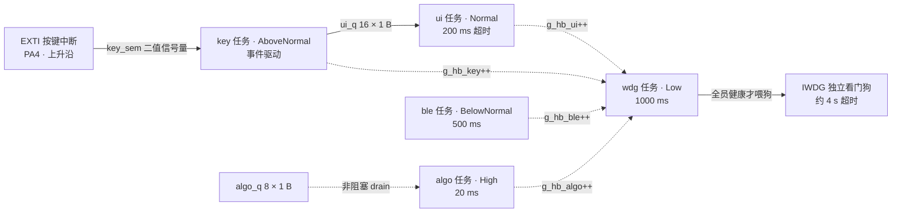

# STM32 + FreeRTOS 智能手环原型

基于 STM32F103C8T6 + FreeRTOS（CMSIS-RTOS v2）的可穿戴设备原型，重点是**实时事件处理链路**与**系统级故障自愈**：按键事件从 EXTI 中断一路走到 UI 任务不丢一个，任一任务卡死时看门狗能在约 4 秒内复位系统，并且复位后还能回答"是谁卡死了、卡了多久"。

## 硬件

| 项目 | 说明 |
| --- | --- |
| MCU | STM32F103C8T6（Cortex-M3） |
| 显示 | SSD1306 OLED（I2C1：**PB8 = SCL / PB9 = SDA**，自研驱动 `Core/Src/ssd1306.c`） |
| 姿态 | MPU6050（挂在同一路 I2C1 上，从机地址 0x68，驱动 `Core/Src/mpu6050.c`） |
| 按键 | PA4 + EXTI（上升沿触发，按下为高电平；改为低电平有效只需改 `KEY_ACTIVE_LEVEL` 并翻转触发沿） |
| 调试输出 | USART1（`printf` 重定向） |
| 看门狗 | IWDG（LSI 约 40 kHz，分频与 reload 见 `Core/Src/iwdg.c`，超时约 4 s） |
| 工具链 | STM32CubeIDE + STM32CubeMX |

## I2C1 总线：为什么用 PB8 / PB9

F103 的 I2C1 有两组引脚：默认组 `PB6 = SCL / PB7 = SDA`，重映射组 `PB8 = SCL / PB9 = SDA`。本项目走重映射组，而且**必须在配置引脚之前打开 AFIO 重映射**：

```c
__HAL_AFIO_REMAP_I2C1_ENABLE();   /* 漏掉这行，PB8/PB9 就只是两个普通 GPIO，I2C1 还留在 PB6/PB7 上 */
```

切换的原因是一次真实的踩坑：原来的 **PB6/SCL 那一路没有外部上拉**（模块侧那颗上拉电阻根本没接到 MCU）。开漏输出只能拉低、不能拉高，于是 SCL 出不了上升沿 → 从机看不到时钟 → 一个都不应答 → **OLED 全黑**，而且每次 NAK 之后 F1 的 I2C 还会把 BUSY 锁死，症状一路伪装成"总线上没有器件"。

这个过程在代码里留了两样东西：

- **`i2c1_recover_bus()`：处理 F1 的 BUSY 假死。** `SR2.BUSY` 的置位条件只有一条 ——"检测到 SDA 或 SCL 为低"；一旦锁上，之后每次 `HAL_I2C_xxx` 都要先白等满 25 ms 才返回 `HAL_BUSY`（`I2C_TIMEOUT_BUSY_FLAG` 是 HAL 里写死的值，改 `Timeout` 参数没用）。**清它只有"整个外设复位"一条路**（`__HAL_RCC_I2C1_FORCE_RESET()`）；关/开 PE、重写一遍寄存器都不行。恢复前还要先把两条线松开抬到高电平，否则一使能 PE 就立刻又锁上（实测这一步做与不做，成功率直接是 1 比 8）。
- **`I2C_BUS_FORENSICS`：总线取证探针（默认关）。** 置 1 后，每次进恢复流程会把外设从线上摘下来，分别用 MCU 内部上拉/下拉各读一次 SCL/SDA：

  | 上拉探针 | 下拉探针 | 说明 |
  | --- | --- | --- |
  | 1 | 1 | 外面有上拉（几 kΩ）→ 这条线是通的 ✔ |
  | 1 | **0** | **外面什么都没有，纯悬空 → 这条线没接到模块** |
  | 0 | 0 | 外面被硬拉低：短路到 GND / 从机死拉 / 未上电器件钳位 |
  | 0 | 1 | 外面硬接了高电平（接错到 VCC） |

> 教训：I2C 出问题时，先把"上拉到底有没有"变成一个可以读的数，比换线、换模块、改速率都省事。

## 软件架构：5 个任务 + 2 个队列 + 1 个信号量

| 任务 | 优先级 | 节拍 | 职责 |
| --- | --- | --- | --- |
| `algo` | High | 20 ms | 数据算法；以非阻塞方式 drain `algo_q` |
| `key` | AboveNormal | 事件驱动 | 信号量唤醒 → 20 ms 消抖窗口 → 确认后投 `ui_q` |
| `ui` | Normal | 200 ms 超时 | 消费 `ui_q`、翻页、刷新显示 |
| `ble` | BelowNormal | 500 ms | 预留蓝牙数据上报 |
| `wdg` | Low | 1000 ms | 心跳巡检 + 决定喂狗 / 停喂 |

任务间通信：

- `key_sem`：二值信号量。**EXTI 中断里只做 `osSemaphoreRelease`**，把消抖、判定、入队这些耗时工作全部甩给 `key` 任务，中断服务时间压到最短。
- `algo_q`（8 × 1 B）、`ui_q`（16 × 1 B）：事件码 `evt_t` 故意只占 1 字节，和队列 Item Size 严丝合缝，不浪费一个字节的拷贝。

### 任务关系图



> 实线是数据通路（信号量 / 队列），虚线是心跳与巡检关系。`algo_q` 目前只保留消费侧。

## 看门狗 + 多任务心跳监控

表驱动结构 `hb_mon_t g_mon[]` 登记每个受监控任务的**心跳变量地址**和**容忍停滞秒数**：

```c
hb_mon_t g_mon[] = {
  { .name = "algo", .hb = &g_hb_algo, .limit = 2 },
  { .name = "ui",   .hb = &g_hb_ui,   .limit = 2 },
  { .name = "ble",  .hb = &g_hb_ble,  .limit = 3 },
};
```

`wdg` 任务每秒取一次快照：心跳值没变 → 停滞秒数 +1，变了 → 清零；停滞秒数 ≥ `limit` 即判定该任务已死。**全部任务健康才刷新 IWDG，只要有任意一个被判定卡死就停止喂狗**，靠硬件看门狗做最终恢复手段。表驱动的好处是新增一个受监控任务只需加一行配置。

### 武装时机：看门狗不监督"启动过程"，只监督"已经站起来的系统"

`MX_IWDG_Init()` 刻意放在 `main()` 里所有启动逻辑跑完之后、`osKernelStart()` 之前，而不是紧跟在外设初始化后面：

- IWDG 一写就开跑，且**无法暂停**；而第一次喂狗要等 `wdg` 任务跑完第一轮 `osDelay(1000)`。也就是说留给"复位 → 调度器起来 + 1 s"的预算只有约 3 秒（超时约 4 秒）。
- 中间那段启动体检在总线异常时想吃掉好几秒太容易了：`i2c_scan` 扫 112 个地址，I2C 卡死时每个地址要白等满 25 ms 的固定 BUSY 超时（`I2C_TIMEOUT_BUSY_FLAG`，改 `Timeout` 参数没用），单这一项就是 2.8 秒。
- 一旦超时就是"上电即复位"，而那次复位发生在调度器启动之前 —— `wdg` 任务永远跑不到，下面那套 boot loop 防护也无从生效，于是变成真正的死循环。

顺带把 `i2c_scan` 的两处启动期开销压掉了：单地址超时 10 ms → 2 ms，并加了"BUSY 不放就立刻放弃扫描"的短路（否则 112 个地址会一个接一个白等过去）。

## 复位之后还能复盘：死亡档案

停喂之前，把"第几个任务 + 停滞了多少秒"写进**备份域寄存器**（`BKP->DR3` / `BKP->DR4`，跨复位不丢），复位后由 `main()` 读出来，于是可以明确回答：

> `algo` 连续停滞 7 秒 → 独立看门狗复位系统

同时：

- `BKP->DR1` 复位计数；`BKP->DR10` 数据签名（签名不对就整份作废，避免读到脏数据）
- 读 `RCC->CSR` 判定复位来源（`IWDGRSTF` 看门狗复位 / `PORRSTF` 上电复位 / `PINRSTF` 引脚复位），读完写 `RMVF` 清掉粘滞标志，为下一次复位做准备

## Boot loop 防护

如果系统一启动就死、复位后又立刻死，会陷入无限重启。这里用 `BKP->DR2` 记连续未存活复位次数：超过 `BOOT_LOOP_MAX` 就判定为疑似 boot loop，允许"带病喂狗"把设备拉起来（并把带病喂狗的秒数单独计数，不和正常喂狗混在一起）；一旦累计存活到 `HEALTHY_SEC` 且期间无死件，就往 `BKP->DR2` 盖一个"够本"印章并撤销 guard。

## 可观测性

所有关键指标都是 `volatile` 全局变量，调试时挂 Live Expressions 即可：

- **按键四级流水**：`g_key_irq`（EXTI 中断次数，含抖动）→ `g_key_bounce`（消抖吃掉的毛刺）→ `g_key_evt`（确认成立并投进 `algo_q`）→ `g_algo_key`（算法处理掉的）。卡在哪一级一眼就看出来。
- **队列健康度**：`g_evt_sent` / `g_evt_recv`（应当近似相等）、`g_evt_putfail`（队列满导致投递失败）、`g_evt_unknown`（收到未定义事件码）
- **看门狗状态**：`g_stall_any`（本秒有几个任务停滞）、`g_dead_secs`（出现过死件的秒数）、`g_wdg_degraded`（带病喂狗秒数）
- **启动耗时**：`g_scan_ms`（总线体检）、`g_init_ms`（OLED 初始化 + 清屏）、`g_boot_ms`（复位到"进调度器前"的总耗时）。看门狗不再监督启动过程，这三个数也就没有"必须小于几秒"的硬约束了，但它们仍是"这台板子上电为什么慢"的第一手证据。
- **I2C 总线**：`g_i2c_found` / `g_i2c_addr1` / `g_ssd1306_online`（启动体检扫到几个器件、都是谁）、`g_mpu_who`（MPU 自报身份，期望 0x68）、`g_mpu_st`（最近一次 HAL 返回值，`2` = `HAL_BUSY`，说明 BUSY 已经假死）、`g_i2c_rec_step`（总线恢复停在哪一步：`0` 无需恢复 / `1` RCC 复位解决 / `2` SWRST 解决 / `3` 敲时钟解决 / `7`、`8` 失败 / `9` `HAL_I2C_Init` 失败）。另外 `I2C_BUS_FORENSICS=1` 时还有一组探针读数。

## 故障注入验证

Debug 构建下有个调试钩子 `g_force_dead`：置 1 即可伪造"1 号任务已判死"，用来验证整条 **判定死件 → 记录死亡档案 → 停喂 → 约 4 s 复位 → 复位后读出死因** 的链路，而不必真的写死循环。这比"手动改代码加个 while(1) 再改回来"更快也更可重复。

## 目录结构

```
Core/Src/freertos.c   任务、队列、信号量、心跳巡检、看门狗逻辑、死亡档案
Core/Src/main.c       时钟/外设初始化、备份域与复位原因解析、boot loop 判定
Core/Src/i2c.c        I2C1 初始化、引脚/重映射、BUSY 假死恢复、取证探针
Core/Src/iwdg.c       IWDG 初始化
Core/Src/ssd1306.c    OLED 驱动
Core/Src/mpu6050.c    MPU6050 三轴读取
Core/Inc/app_events.h 事件码定义（1 字节）
Core/Inc/FreeRTOSConfig.h  FreeRTOS 裁剪配置
```

> 说明：`Drivers/`（HAL + CMSIS）与 `Middlewares/`（FreeRTOS 源码）是 STM32CubeMX 生成/引入的第三方库，未纳入版本库；用 CubeMX 打开根目录的 `smart_watch.ioc` 即可重新生成，应用层代码全部在 `Core/` 下。

## 已知限制与下一步

- 计步算法还没写：`algo` 目前只做三轴采集 + 一阶低通（`g_axf` / `g_ayf` / `g_azf`）并直接上屏（P1）
- 蓝牙数据上报仍为占位任务（P2）
- `ui` 任务目前只是按 `g_ui_page` 翻页 + 画三条加速度柱状条，多页面绘制流程还没做
- `led_Pin` 配的是 **PB1**，而 Blue Pill 的板载 LED 其实在 **PC13**；如果 PB1 上没外接 LED，这个"灯"并不存在（代码里也只在初始化时拉高一次，没有翻转动作，`g_ui_refresh` 同样是预留、还没人赋值）
- `I2C_USE_INTERNAL_PULLUP` 是排障用的"救命档"，**默认关闭**（走外部上拉 + 400 kHz）。打开会用 MCU 内部 30~50 kΩ 顶替模块侧上拉，并把速率降到 100 kHz —— 只在外部上拉缺失时应急