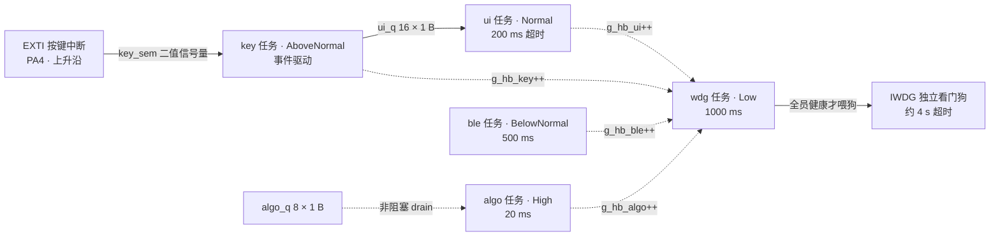

# STM32 + FreeRTOS 智能手环原型

基于 STM32F103C8T6 + FreeRTOS（CMSIS-RTOS v2）的可穿戴设备原型，重点是**实时事件处理链路**与**系统级故障自愈**：按键事件从 EXTI 中断一路走到 UI 任务不丢一个，任一任务卡死时看门狗能在约 4 秒内复位系统，并且复位后还能回答"是谁卡死了、卡了多久"。

## 硬件

| 项目 | 说明 |
| --- | --- |
| MCU | STM32F103C8T6（Cortex-M3） |
| 显示 | SSD1306 OLED（I2C1，自研驱动 `Core/Src/ssd1306.c`） |
| 按键 | PA4 + EXTI（上升沿触发，按下为高电平；改为低电平有效只需改 `KEY_ACTIVE_LEVEL` 并翻转触发沿） |
| 调试输出 | USART1（`printf` 重定向） |
| 看门狗 | IWDG（LSI 约 40 kHz，分频与 reload 见 `Core/Src/iwdg.c`，超时约 4 s） |
| 工具链 | STM32CubeIDE + STM32CubeMX |

## 软件架构：5 个任务 + 2 个队列 + 1 个信号量

| 任务 | 优先级 | 节拍 | 职责 |
| --- | --- | --- | --- |
| `algo` | High | 20 ms | 数据算法；以非阻塞方式 drain `algo_q` |
| `key` | AboveNormal | 事件驱动 | 信号量唤醒 → 20 ms 消抖窗口 → 确认后投 `ui_q` |
| `ui` | Normal | 200 ms 超时 | 消费 `ui_q`、翻页、刷新显示 |
| `ble` | BelowNormal | 500 ms | 预留蓝牙数据上报 |
| `wdg` | Low | 1000 ms | 心跳巡检 + 决定喂狗 / 停喂 |

任务间通信：

- `key_sem`：二值信号量。**EXTI 中断里只做 `osSemaphoreRelease`**，把消抖、判定、入队这些耗时工作全部甩给 `key` 任务，中断服务时间压到最短。
- `algo_q`（8 × 1 B）、`ui_q`（16 × 1 B）：事件码 `evt_t` 故意只占 1 字节，和队列 Item Size 严丝合缝，不浪费一个字节的拷贝。

### 任务关系图



> 实线是数据通路（信号量 / 队列），虚线是心跳与巡检关系。`algo_q` 目前只保留消费侧。

## 看门狗 + 多任务心跳监控

表驱动结构 `hb_mon_t g_mon[]` 登记每个受监控任务的**心跳变量地址**和**容忍停滞秒数**：

```c
hb_mon_t g_mon[] = {
  { .name = "algo", .hb = &g_hb_algo, .limit = 2 },
  { .name = "ui",   .hb = &g_hb_ui,   .limit = 2 },
  { .name = "ble",  .hb = &g_hb_ble,  .limit = 3 },
};
```

`wdg` 任务每秒取一次快照：心跳值没变 → 停滞秒数 +1，变了 → 清零；停滞秒数 ≥ `limit` 即判定该任务已死。**全部任务健康才刷新 IWDG，只要有任意一个被判定卡死就停止喂狗**，靠硬件看门狗做最终恢复手段。表驱动的好处是新增一个受监控任务只需加一行配置。

## 复位之后还能复盘：死亡档案

停喂之前，把"第几个任务 + 停滞了多少秒"写进**备份域寄存器**（`BKP->DR3` / `BKP->DR4`，跨复位不丢），复位后由 `main()` 读出来，于是可以明确回答：

> `algo` 连续停滞 7 秒 → 独立看门狗复位系统

同时：

- `BKP->DR1` 复位计数；`BKP->DR10` 数据签名（签名不对就整份作废，避免读到脏数据）
- 读 `RCC->CSR` 判定复位来源（`IWDGRSTF` 看门狗复位 / `PORRSTF` 上电复位 / `PINRSTF` 引脚复位），读完写 `RMVF` 清掉粘滞标志，为下一次复位做准备

## Boot loop 防护

如果系统一启动就死、复位后又立刻死，会陷入无限重启。这里用 `BKP->DR2` 记连续未存活复位次数：超过 `BOOT_LOOP_MAX` 就判定为疑似 boot loop，允许"带病喂狗"把设备拉起来（并把带病喂狗的秒数单独计数，不和正常喂狗混在一起）；一旦累计存活到 `HEALTHY_SEC` 且期间无死件，就往 `BKP->DR2` 盖一个"够本"印章并撤销 guard。

## 可观测性

所有关键指标都是 `volatile` 全局变量，调试时挂 Live Expressions 即可：

- **按键四级流水**：`g_key_irq`（EXTI 中断次数，含抖动）→ `g_key_bounce`（消抖吃掉的毛刺）→ `g_key_evt`（确认成立并投进 `algo_q`）→ `g_algo_key`（算法处理掉的）。卡在哪一级一眼就看出来。
- **队列健康度**：`g_evt_sent` / `g_evt_recv`（应当近似相等）、`g_evt_putfail`（队列满导致投递失败）、`g_evt_unknown`（收到未定义事件码）
- **看门狗状态**：`g_stall_any`（本秒有几个任务停滞）、`g_dead_secs`（出现过死件的秒数）、`g_wdg_degraded`（带病喂狗秒数）

## 故障注入验证

Debug 构建下有个调试钩子 `g_force_dead`：置 1 即可伪造"1 号任务已判死"，用来验证整条 **判定死件 → 记录死亡档案 → 停喂 → 约 4 s 复位 → 复位后读出死因** 的链路，而不必真的写死循环。这比"手动改代码加个 while(1) 再改回来"更快也更可重复。

## 目录结构

```
Core/Src/freertos.c   任务、队列、信号量、心跳巡检、看门狗逻辑、死亡档案
Core/Src/main.c       时钟/外设初始化、备份域与复位原因解析、boot loop 判定
Core/Src/iwdg.c       IWDG 初始化
Core/Src/ssd1306.c    OLED 驱动
Core/Inc/app_events.h 事件码定义（1 字节）
Core/Inc/FreeRTOSConfig.h  FreeRTOS 裁剪配置
```

> 说明：`Drivers/`（HAL + CMSIS）与 `Middlewares/`（FreeRTOS 源码）是 STM32CubeMX 生成/引入的第三方库，未纳入版本库；用 CubeMX 打开根目录的 `smart_watch.ioc` 即可重新生成，应用层代码全部在 `Core/` 下。

## 已知限制与下一步

- 尚未接入 MPU6050 加速度采样与自写计步算法（P1）
- 蓝牙数据上报仍为占位任务（P2）
- `ui` 任务目前只更新页面编号，尚未驱动实际 OLED 绘制流程